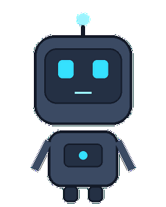
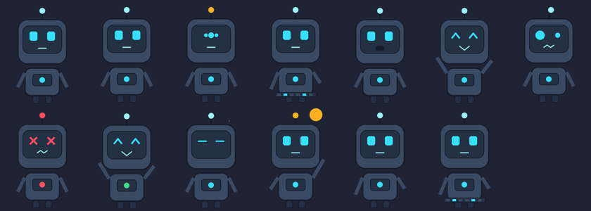
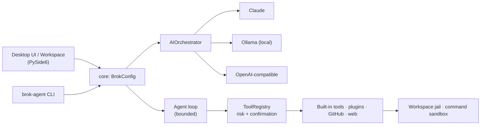

<div align="center">



# Brok

**A Persian-first AI desktop companion and a permission-controlled coding agent.**

A small robot that lives on your desktop, talks to you in Persian (and English and more), and can work on your
code with explicit, auditable permissions — locally with Ollama or in the cloud with Claude / any OpenAI-compatible API.

[](https://github.com/Barman-Zarei/Brok/actions/workflows/ci.yml)


EN · [FA](docs/README_FA.md) · [RU](docs/README_RU.md) · [CN](docs/README_CN.md) · [ID](docs/README_ID.md) · [KO](docs/README_KO.md)

[Quick start](#-quick-start) · [Features](#-features) · [Security](#-security-model) · [Architecture](#-architecture) · [Branches](#-branches-and-build-profiles) · [Contributing](#-contributing)



</div>

---

> **Branch `OFFLINE` — fully local.** See [docs/BRANCH.md](docs/BRANCH.md).

## Contents

- [Why Brok](#-why-brok)
- [Features](#-features)
- [Quick start](#-quick-start)
- [Usage](#-usage)
- [Security model](#-security-model)
- [Privacy](#-privacy)
- [Architecture](#-architecture)
- [Configuration](#-configuration)
- [Branches and build profiles](#-branches-and-build-profiles)
- [Platform support](#-platform-support)
- [Development](#-development)
- [Project status](#-project-status)
- [Troubleshooting](#-troubleshooting)
- [Contributing](#-contributing)
- [License and attribution](#-license-and-attribution)

## ✨ Why Brok

Most AI coding assistants are English-first, cloud-only and run with broad access to your machine. Brok is built
around three ideas:

- **Persian first.** A right-to-left interface, Persian explanations with English code, a learning mode and a
  Persian-aware debugger — and it speaks other languages too.
- **You stay in control.** Every action a model can take is a tool with a risk level and a confirmation rule.
  Edits are shown as a diff first; deleting, committing and pushing always ask; dangerous commands are refused
  before any prompt. See the [security model](#-security-model).
- **Local or cloud, visibly.** Use Ollama on your own machine, or Claude / an OpenAI-compatible API. The UI always
  shows whether you are talking to a **LOCAL AI** or a **CLOUD AI**, and a local-only mode never touches the network.

## 🧰 Features

| Area | What you get |
|---|---|
| **Companion** | Frameless, always-on-top, draggable robot avatar with 13 states (idle, listening, thinking, typing, coding, working, speaking, happy, confused, error, success, sleeping, notification); extra avatar packs via `pack.json`; custom characters. |
| **AI providers** | Claude, Ollama (local) and any OpenAI-compatible API behind one orchestrator with fallbacks; the UI never calls a vendor directly. |
| **Coding workspace** | File explorer, editor, AI chat, diff viewer, terminal, problems, git and project info. Select code → *Explain / Find bug / Optimize / Write tests / To Flutter*. |
| **Coding agent** | Bounded loop (limits on steps, time, tokens and tool calls), project index, AI debugger, health report, learning mode. Cancel and deadline are enforced before every tool call. |
| **Terminal agent** | `brok-agent ask · code · fix · debug · learn · health · doctor · privacy · memory` |
| **Memory & privacy** | View / edit / delete / clear what Brok remembers; a privacy report of what is stored and sent; keys only from environment variables or the OS keyring. |
| **Extensibility** | Plugin API (plugin tools can never lower a tool's risk), GitHub REST and web-research tools, voice interfaces (STT/TTS). |
| **From myCat** | Reminders, activity diary, focus timer, GitHub notifications, calendar reminders, custom characters, character shop. |

## 🚀 Quick start

```bash
pip install .                 # or: pip install ".[secure,calendar]"
brok                          # start the desktop companion

# Pick a brain: cloud ...
export ANTHROPIC_API_KEY=...  # (or OPENAI_API_KEY for an OpenAI-compatible API)
# ... or local:
ollama pull llama3.1

brok-agent doctor             # check providers and connectivity
brok-agent --project . ask "What does this project do?"
```

Requires **Python 3.8+** (3.10+ recommended; 3.8 is end-of-life). See [docs/PYTHON_COMPATIBILITY.md](docs/PYTHON_COMPATIBILITY.md). From a checkout you can also use `run.sh` (Linux/macOS)
or `run.bat` (Windows).

<details>
<summary><b>Docker</b> (GUI forwarded to your host's X server)</summary>

Prerequisites: Docker and an X server on the host (Xorg on Linux, VcXsrv on Windows, XQuartz on macOS).

```bash
# Linux
xhost +local:docker
docker compose up --build

# Windows (VcXsrv running, network clients allowed)
docker compose -f docker-compose.windows.yml up

# macOS (XQuartz running, network clients allowed)
docker compose -f docker-compose.mac.yml up
```
</details>

## 🎮 Usage

**Desktop.** `brok` — left-drag to move, right-click for the menu (including *Coding Workspace…*).
Options: `--image path/to/char.zip` (custom character), `--pos X Y`, `--wait SECONDS`, `--debug`.

**Terminal.** `brok-agent [--project PROJECT] <command>`:

| Command | Purpose |
|---|---|
| `ask` / `code` / `fix` | Natural language or `/command` text |
| `debug` | Analyse an error or traceback (text or file) |
| `learn` | Learning mode |
| `health` | Heuristic project health report |
| `doctor` | Check providers and connection |
| `privacy` | What Brok stores and sends |
| `memory` | View / add / delete / clear memory |

Settings live in `~/.config/brok/` (a legacy `~/.config/mycat` is copied once, never deleted).

## 🔒 Security model

Every tool a model can call is a `ToolSpec` with a risk level, executed only through `ToolRegistry.execute`.

| Tool | Risk | Confirmation |
|---|---|---|
| read / list / search, git status / diff / log / branch, inspect | LOW | none |
| write / create / move, git checkout / stash, run tests / linter / formatter, `fetch_url` | MEDIUM | configurable |
| `delete_file`, `git_commit`, `github_create_*` | HIGH | required |
| `git_push`, sudo / system / remote-changing commands | CRITICAL | always (no setting skips it) |
| dangerous commands (`rm -rf /`, `mkfs`, `dd` to disk, `curl \| sh`, credential files, fork bomb…) | BLOCKED | refused before any prompt |

- **Workspace jail** — paths are resolved with `realpath`; escaping the project (`..`, absolute paths, symlinks) is
  refused, and the `.git` directory is off-limits to file tools.
- **Secrets stay out** — `.env`, `*.pem`, `*.key` and SSH keys cannot be read or written by the agent, and
  `git_commit` never stages them.
- **No shell** — commands run as an argument list with API-key/token variables scrubbed, a timeout and an output cap;
  a running command is killed (with everything it spawned) on cancel or timeout.
- **Network guard** — `fetch_url` accepts only public http(s) targets and re-checks every redirect and the address it
  actually connected to (SSRF and DNS-rebinding protection).
- **Plugins cannot lower risk** — their tools are floored at MEDIUM / configurable.

**Limits you should know:** command classification is pattern-based and can be fooled by obfuscation (which is why
anything unlisted asks first), there is no OS-level sandbox or container yet, and `health` findings are heuristic —
not a security audit. Details: [docs/security.md](docs/security.md).

## 🛡️ Privacy

Brok shows what it stores and sends (`brok-agent privacy`, privacy dashboard in the UI), lets you view, edit and delete
its memory, refuses to store text that looks like a secret, and never writes API keys to config, logs or memory
(`redact()` masks them). Local-only mode keeps everything on your machine. See [docs/privacy.md](docs/privacy.md).

## 🧱 Architecture



The UI never calls a vendor API — only `AIOrchestrator` does. There are no Qt imports in `ai/`, `agent/`,
`memory` or `config`, so the core is unit-testable headless. Module map and rules:
[docs/architecture.md](docs/architecture.md) · [AI](docs/ai.md) · [coding agent](docs/coding-agent.md) ·
[plugins](docs/plugins.md).

## ⚙️ Configuration

User settings are in `~/.config/brok/` (`config.ini`, written atomically and readable only by you). Keys come from
environment variables or the OS keyring. Runtime profile can be overridden anywhere with
`BROK_PROFILE=<name>` (`standard`, `lite`, `low-end`, `no-gpu`, `offline`, `experimental`; branch-style spellings such
as `NO_GPU` also work on the profile branches). Full reference: [docs/configuration.md](docs/configuration.md).

## 🌿 Branches and build profiles

`brok-migration` is the **main line**. Every other branch is a variant that shares its code; fixes are merged from
`brok-migration` into them.

| Branch | What it is | Python |
|---|---|---|
| `brok-migration` | Main version | 3.10+ |
| `PYTHON38` | Python 3.8 compatibility | 3.8+ |
| `LEGACY` | Older operating systems, pinned old dependencies | 3.9 |
| `WIN7` | Windows 7 via Qt 5.15 / PySide2 | 3.8 – 3.10 |
| `LOW-END` | Weak PCs: ~15 fps avatar, no update check | 3.8+ |
| `OFFLINE` | Ollama only, no cloud AI, no update check | 3.8+ |
| `LITE` | `pyside6-essentials` instead of full PySide6 (smaller install) | 3.8+ |
| `NO_GPU` | Qt software rendering | 3.8+ |
| `EXPERIMENTAL` | Unstable work, DEBUG logging | 3.8+ |
| `ANDROID` | APK via `pyside6-android-deploy` (experimental) | 3.10+ |
| `IOS` | Xcode project via Qt tooling (experimental) | 3.10+ |

The variant branches carry a `docs/BRANCHES.md` with the build details; `main` is the 0.2.0 release base.

## 🖥️ Platform support

| Platform | Status |
|---|---|
| Linux | **Primary** — developed and tested here (headless Qt) |
| Windows 10+ / macOS | Expected to work; not yet verified on real machines |
| Windows 7 | `WIN7` branch (PySide2); tested on Linux only, **not on Windows 7 itself** |
| Android / iOS | Entry points only; build workflows have never been run |

## 🧪 Development

```bash
pip install -e ".[dev]"
QT_QPA_PLATFORM=offscreen pytest -q      # 550+ tests, headless
ruff check . && ruff format --check .    # lint / format
mypy --strict <core modules>             # as in CI
```

CI runs the test matrix on several Python versions and `mypy --strict` on the core modules (see
[`.github/workflows/ci.yml`](.github/workflows/ci.yml)). More in [CONTRIBUTING.md](CONTRIBUTING.md) and
[docs/development.md](docs/development.md). Release notes: [CHANGELOG.md](CHANGELOG.md).

## 📌 Project status

**Alpha (0.2.0).** The core — providers, tools, permissions, agent loop, memory, project index, avatar, workspace UI,
hotkeys — is covered by automated tests (headless, Linux; Python 3.8 – 3.12). **Not verified by the authors:** real
Claude / OpenAI / Ollama / GitHub calls with live keys, Windows and macOS builds, a physical display, microphone
speech-to-text (the interface and OS text-to-speech exist). Please report problems in the
[issue tracker](https://github.com/Barman-Zarei/Brok/issues).

## 🔧 Troubleshooting

| Symptom | Try |
|---|---|
| Cat in a black box (no transparency) | X11 needs a compositor; Brok clips to the outline when none runs. Enable one if the box persists. |
| Window not on top / not in taskbar | Some window managers override "always on top" — check WM settings or restart the session. |
| Custom character won't load | Check the path and that the archive is valid; see [docs/CHARS.md](docs/CHARS.md). |
| Position not saving | `~/.config/brok/` must exist and be writable. |
| Windows launch problems | Use Python 3.10+ (or the prebuilt `.exe`); check `python -c "import PySide6"`. |
| Permission errors on Linux | Prefer `pip install --user brok` over `sudo`. |

More: [docs/troubleshooting.md](docs/troubleshooting.md). When opening an issue include your OS, desktop environment,
Python version and any terminal output.

## 🤝 Contributing

Contributions are welcome — bug reports, tests, translations and code. Read [CONTRIBUTING.md](CONTRIBUTING.md) for the
development setup and conventions. Please run the tests and the linter before opening a pull request.

## 📄 License and attribution

Brok is distributed under the [MIT CAT License (Meow-IT)](LICENSE.txt).

Brok is a derivative work of **[myCat](https://github.com/yumiaura/myCat)** — © 2025 @yumicabrera, whose original
copyright and permission notice is retained as the license requires. Brok-original code, architecture and features:
© 2026 Barman. See [NOTICE](NOTICE).

<div align="center">

Made with ❤️ for developers who think in Persian. 🐾

</div>
